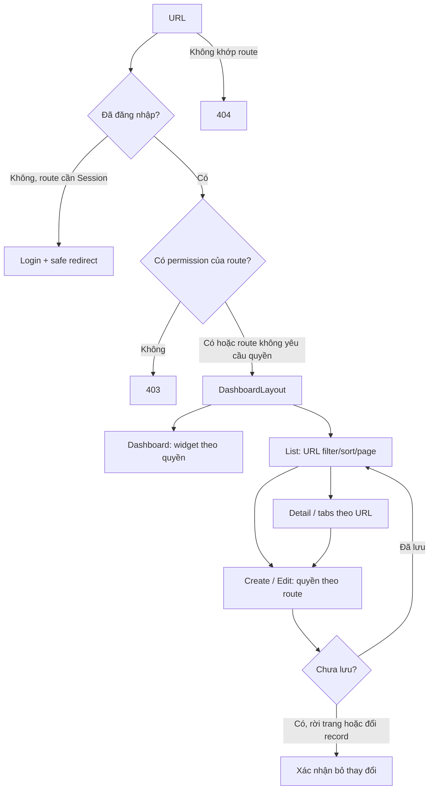

# Sơ đồ điều hướng CMS

Nguồn route: [`Routes.ts`](../../src/app/router/Routes.ts). Guard: [`Guards.ts`](../../src/app/router/Guards.ts). Sidebar, breadcrumb và title lấy từ [`Navigation.ts`](../../src/layouts/Navigation.ts).

## Routes

Đối chiếu ngày 26/11/2026. Route dưới DashboardLayout kế thừa `requiresAuth`; bảng ghi permission khai báo tại route (không đồng nghĩa mọi feature đã nối API). Nguồn là các route module được ghép ở `Routes.ts`.

AuthLayout chứa `/login`, `/forgot-password` (`guestOnly`) và `/reset-password` (không guestOnly, để người đang đăng nhập vẫn dùng link email). Auth routes không cần permission. `/403` thuộc DashboardLayout; 404 đứng ngoài layout. Không có route `/settings/localization` hoặc `/design-system` trong danh sách được ghép hiện tại.

| URL                           | Permission route                         | View / redirect                                                                     |
| ----------------------------- | ---------------------------------------- | ----------------------------------------------------------------------------------- |
| `/internal-accounts`          | `ADMINISTRATION_INTERNAL_ACCOUNT_VIEW`   | [InternalAccountListView](../../src/features/accounts/InternalAccounts.routes.ts)   |
| `/internal-accounts/new`      | `ADMINISTRATION_INTERNAL_ACCOUNT_MANAGE` | [InternalAccountCreateView](../../src/features/accounts/InternalAccounts.routes.ts) |
| `/internal-accounts/:id/edit` | `ADMINISTRATION_INTERNAL_ACCOUNT_VIEW`   | [InternalAccountEditView](../../src/features/accounts/InternalAccounts.routes.ts)   |
| `/categories`                 | `CATALOG_CATEGORY_VIEW`                  | [CategoryListView](../../src/features/categories/Categories.routes.ts)              |
| `/categories/new`             | `CATALOG_CATEGORY_MANAGE`                | [CategoryCreateView](../../src/features/categories/Categories.routes.ts)            |
| `/categories/:id/edit`        | `CATALOG_CATEGORY_MANAGE`                | [CategoryEditView](../../src/features/categories/Categories.routes.ts)              |
| `/colors`                     | `CATALOG_PRODUCT_OPTION_VIEW`            | [ColorListView](../../src/features/colors/Colors.routes.ts)                         |
| `/colors/new`                 | `CATALOG_PRODUCT_OPTION_MANAGE`          | [ColorEditView](../../src/features/colors/Colors.routes.ts)                         |
| `/colors/:id/edit`            | `CATALOG_PRODUCT_OPTION_MANAGE`          | [ColorEditView](../../src/features/colors/Colors.routes.ts)                         |
| `/customers`                  | `customer:read`                          | [CustomerListView](../../src/features/customers/Customers.routes.ts)                |
| `/customers/:id`              | `customer:read`                          | [CustomerDetailView](../../src/features/customers/Customers.routes.ts)              |
| `/`                           | `—`                                      | [DashboardView](../../src/features/dashboard/Dashboard.routes.ts)                   |
| `/inventory`                  | `inventory:read`                         | [InventoryListView](../../src/features/inventory/Inventory.routes.ts)               |
| `/inventory/movements`        | `inventory:read`                         | [InventoryMovementListView](../../src/features/inventory/Inventory.routes.ts)       |
| `/orders`                     | `order:read`                             | [OrderListView](../../src/features/orders/Orders.routes.ts)                         |
| `/orders/:id`                 | `order:read`                             | [OrderDetailView](../../src/features/orders/Orders.routes.ts)                       |
| `/products`                   | `CATALOG_PRODUCT_VIEW`                   | [ProductListView](../../src/features/products/Products.routes.ts)                   |
| `/products/new`               | `CATALOG_PRODUCT_MANAGE`                 | [ProductCreateView](../../src/features/products/Products.routes.ts)                 |
| `/products/:id/edit`          | `CATALOG_PRODUCT_VIEW`                   | [ProductEditView](../../src/features/products/Products.routes.ts)                   |
| `/roles`                      | `ADMINISTRATION_ROLE_VIEW`               | [RoleListView](../../src/features/roles/Roles.routes.ts)                            |
| `/roles/new`                  | `ADMINISTRATION_ROLE_MANAGE`             | [RoleCreateView](../../src/features/roles/Roles.routes.ts)                          |
| `/roles/:id/edit`             | `ADMINISTRATION_ROLE_VIEW`               | [RoleEditView](../../src/features/roles/Roles.routes.ts)                            |
| `/settings`                   | `settings:read`                          | [Redirect /settings/store](../../src/features/settings/Settings.routes.ts)          |
| `/settings/store`             | `settings:write`                         | [StoreSettingsView](../../src/features/settings/Settings.routes.ts)                 |
| `/sizes`                      | `CATALOG_PRODUCT_OPTION_VIEW`            | [SizeListView](../../src/features/sizes/Sizes.routes.ts)                            |
| `/sizes/new`                  | `CATALOG_PRODUCT_OPTION_MANAGE`          | [SizeEditView](../../src/features/sizes/Sizes.routes.ts)                            |
| `/sizes/:id/edit`             | `CATALOG_PRODUCT_OPTION_MANAGE`          | [SizeEditView](../../src/features/sizes/Sizes.routes.ts)                            |
| `/vouchers`                   | `PRICING_VOUCHER_VIEW`                   | [VoucherListView](../../src/features/vouchers/Vouchers.routes.ts)                   |
| `/vouchers/new`               | `PRICING_VOUCHER_MANAGE`                 | [VoucherCreateView](../../src/features/vouchers/Vouchers.routes.ts)                 |
| `/vouchers/:id/edit`          | `PRICING_VOUCHER_VIEW`                   | [VoucherEditView](../../src/features/vouchers/Vouchers.routes.ts)                   |
| `/products/:id`               | Kiểm tại route đích                      | Redirect `/products/:id/edit`                                                       |

Editor products, internal accounts, roles và vouchers mở bằng quyền VIEW; thao tác thay đổi cần quyền MANAGE. Vì vậy không suy quyền write chỉ từ hậu tố `/edit`. `/settings` redirect sang `/settings/store`; guard kiểm quyền của route đích.

Guard gọi `ensureUser()` trước khi kiểm quyền; guestOnly thử restore Session trước khi quyết định về trang chủ. Sidebar/title/command suy từ navigation và `can()`. Backend phải kiểm authorization độc lập. Một số route chưa nối contract vẫn giữ quyền tạm như `order:read`, `inventory:read`, `customer:read`, `settings:write`; xem [Permission.ts](../../src/shared/lib/api/Permission.ts) và [API readiness](../plans/api-restructure/README.md).

## URL và Session

- List filter/sort/page: `useListState`, Zod parse từng field, debounce search, reset page khi đổi filter. Back/forward khôi phục list.
- Customer tabs: `?tab=profile|addresses|orders|activity`; tab Orders cần `order:read`, phân trang cũng ở URL và query bị giới hạn theo customer ID.
- Đổi locale/theme không đổi URL. Locale CMS là ngôn ngữ giao diện, không tự tạo route cấu hình localization Storefront.
- Đăng nhập về safe redirect hoặc `/`; logout phát sự kiện Session và App runtime điều hướng `/login`.
- Session xoá cache khi logout; không có StoreScope hoặc đổi Store. Query key không chứa Store ID.

## Trạng thái tích hợp

Backend và Generated API đã có; mức độ tích hợp từng feature theo [restructure plan](../plans/api-restructure/README.md). [API contracts của prototype](../archive/cms-initial-build/api-contracts.md) chỉ là lịch sử, không phải contract hiện hành. Development/production dùng Backend; HTTP adapter giả chỉ là test seam. CI hiện có Playwright E2E theo [workflow](../../.github/workflows/ci.yml); báo cáo “hoãn E2E” cũ không mô tả CI hiện tại.
