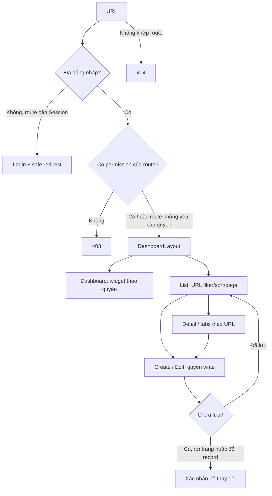

# Sơ đồ điều hướng CMS

Nguồn route: [`Routes.ts`](../src/app/router/Routes.ts). Guard: [`Guards.ts`](../src/app/router/Guards.ts). Sidebar, breadcrumb và title lấy từ [`Navigation.ts`](../src/layouts/Navigation.ts).

## Routes

Các route dưới đây nằm trong DashboardLayout và cần Session. AuthLayout chứa `/login` và `/forgot-password` (guestOnly). `/design-system` chỉ có ở DEV; 404 đứng ngoài layout.

| Đường dẫn                                   | Quyền                                | View                                         |
| ------------------------------------------- | ------------------------------------ | -------------------------------------------- |
| `/`                                         | Widget tự kiểm quyền                 | DashboardView                                |
| `/products`                                 | product:read                         | ProductListView                              |
| `/products/new`                             | product:write                        | ProductCreateView                            |
| `/products/:id`                             | product:read                         | ProductDetailView                            |
| `/products/:id/edit`                        | product:write                        | ProductEditView                              |
| `/categories`                               | category:read                        | CategoryListView                             |
| `/categories/new`, `/categories/:id/edit`   | category:write                       | CategoryCreateView / CategoryEditView        |
| `/orders`, `/orders/:id`                    | order:read                           | OrderListView / OrderDetailView              |
| `/customers`, `/customers/:id`              | customer:read                        | CustomerListView / CustomerDetailView        |
| `/inventory`, `/inventory/movements`        | inventory:read                       | InventoryListView / StockMovementListView    |
| `/promotions`                               | promotion:read                       | PromotionListView                            |
| `/promotions/new`, `/promotions/:id/edit`   | promotion:write                      | PromotionCreateView / PromotionEditView      |
| `/users`                                    | user:read                            | UserListView                                 |
| `/users/new`, `/users/:id/edit`             | user:write                           | UserCreateView / UserEditView                |
| `/roles`                                    | role:read                            | RoleListView                                 |
| `/roles/new`, `/roles/:id/edit`             | role:write                           | RoleCreateView / RoleEditView                |
| `/settings`                                 | settings:read trên khai báo redirect | Redirect `/settings/store`                   |
| `/settings/store`, `/settings/localization` | settings:write ở route đích          | StoreSettingsView / LocalizationSettingsView |

Guard tải current user trước khi kiểm quyền. Dashboard cũng tải user khi mở trực tiếp sau reload để quyền widget và sidebar sẵn sàng. Các action bulk, đổi/hủy trạng thái đơn, điều chỉnh tồn kho kiểm quyền write ở View; backend tương lai vẫn phải kiểm quyền độc lập.

## URL và Session

- List filter/sort/page: `useListState`, Zod parse từng field, debounce search, reset page khi đổi filter. Back/forward khôi phục list.
- Customer tabs: `?tab=profile|addresses|orders|activity`; tab Orders cần `order:read`, phân trang cũng ở URL và query bị giới hạn theo customer ID.
- Đổi locale/theme không đổi URL. Locale CMS tách khỏi cấu hình ngôn ngữ storefront trong Settings.
- Đăng nhập về safe redirect hoặc `/`; logout phát sự kiện Session và App runtime điều hướng `/login`.
- Session xoá cache khi đổi Store. Query key không lặp Store ID.

## Trạng thái tích hợp

BE đã có OpenAPI; contract xác nhận tại [API contracts](./plans/cms-pages-components/api-contracts.md). View test vẫn dùng HTTP adapter giả tại boundary, nhưng development và production đều gọi BE thật. E2E được hoãn theo lựa chọn của người phụ trách.
