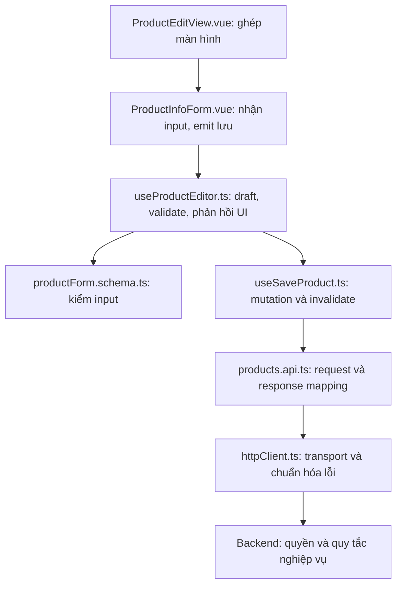

# Thiết kế đích và lộ trình chuyển cấu trúc CMS

Ngày cập nhật: 26/11/2026. Trạng thái: **thiết kế đã duyệt**; Q1–Q19 được xác nhận ngày 26/11/2026 theo [design map](../../.scratch/cms-architecture-design/map.md). Chưa triển khai source hoặc cập nhật rule hiện hành. Quyết định đã duyệt nằm ở [ADR 0001](../adr/0001-domain-workflows-and-vue-naming.md) (tổ chức, naming, phần CONVENTIONS bị thay), [ADR 0002](../adr/0002-state-runtime-and-session.md) (state, runtime, session) và [ADR 0003](../adr/0003-backend-api-boundary.md) (ranh giới Backend, typing). Cây dưới thể hiện trách nhiệm; tên file minh hoạ và các nhánh ghi “đề xuất” chưa phải inventory/mapping đã kiểm đủ.

## Nguyên tắc chia file

Một file có một nhiệm vụ chính và một lý do thay đổi rõ. Có thể chứa các hàm/type liên quan trực tiếp đến cùng nhiệm vụ; không bắt mỗi hàm/type thành một file. Component nhỏ vẫn được giữ local state; chỉ tách khi có trách nhiệm khác, logic đủ lớn hoặc consumer dùng lại thật.

- View ghép màn hình và nối các thành phần; không tự gọi HTTP/map DTO.
- Component nhận props, phát emits và quản lý UI local; component dùng lại không phụ thuộc API/router/store nghiệp vụ.
- Composable `useX` quản lý state và tương tác Vue của chức năng.
- Query quản lý server state, query keys, loading/refetch/invalidation; không chứa form/toast/điều hướng màn hình.
- Endpoint gọi Backend, chuẩn bị request và chuyển response; không import module nghiệp vụ hoặc Vue Query.
- Mapper chỉ tách khi chuyển đổi dữ liệu đủ ý nghĩa/phức tạp; không tạo để copy field 1:1.
- Schema form kiểm input chức năng; schema API kiểm dữ liệu ở boundary khi có nhu cầu runtime validation. Generated types không thay runtime validation.
- Service xử lý quy trình nhiều bước khi cần độc lập Vue; không thêm lớp chỉ chuyển tiếp một endpoint. Helper thuần có thể mang tên hành động trực tiếp.
- Types đi theo owner; type/props một file dùng đặt cạnh consumer. Không nhân bản contract chỉ để đủ tầng.
- Test cạnh source kiểm hành vi, không chỉ kiểm tên file, export hoặc suffix.

Đây là cách làm clean code của CMS: trách nhiệm rõ, dependency có hướng, ít state trùng, tên cụ thể và kiểm thử hành vi. Cây folder tự nó không chứng minh chất lượng code.

## Cây tổng thể

```text
cms/
├── src/
│   ├── app/
│   │   ├── runtime.ts                  # Tạo/nối runtime chung production và test
│   │   ├── config/
│   │   │   ├── env.config.ts           # Kiểm cấu hình môi trường
│   │   │   └── ui.config.ts            # Mặc định Nuxt UI
│   │   ├── providers/                  # Cài plugin và xử lý lỗi global
│   │   ├── router/
│   │   │   ├── router.ts               # Tạo router
│   │   │   ├── routes.ts               # Ghép route nghiệp vụ/layout/fallback
│   │   │   └── guards.ts               # Kiểm đăng nhập và quyền truy cập
│   │   └── views/
│   │       ├── NotFoundView.vue
│   │       └── ForbiddenView.vue
│   ├── layouts/
│   │   ├── DashboardLayout.vue
│   │   ├── AuthLayout.vue
│   │   └── components/                 # Header/sidebar/navigation của layout
│   ├── modules/
│   │   ├── products/                   # Chi tiết ở cây bên dưới
│   │   ├── categories/
│   │   ├── orders/
│   │   ├── inventory/
│   │   ├── vouchers/
│   │   ├── customers/
│   │   ├── accounts/
│   │   ├── roles/
│   │   ├── auth/
│   │   ├── settings/
│   │   ├── dashboard/
│   │   ├── sizes/
│   │   └── colors/
│   ├── integrations/
│   │   └── backend/
│   │       ├── client/                 # HTTP, headers, refresh seam
│   │       ├── session/                # Token, refresh, kết thúc phiên (Q17)
│   │       ├── endpoints/              # Request/response theo API Backend
│   │       ├── generated/              # Output generator, không sửa tay
│   │       ├── schemas/                # Kiểm dữ liệu API khi cần
│   │       ├── mappers/                # Đề xuất, chỉ tách khi mapping cần file riêng
│   │       └── errors/                 # Đề xuất, kiểu lỗi và phân loại lỗi Backend
│   ├── shared/
│   │   ├── components/                 # UI không biết nghiệp vụ
│   │   ├── composables/                # Xử lý trạng thái/tương tác Vue dùng chung
│   │   ├── form/                       # Gắn lỗi API vào form và helper form
│   │   └── formatting/                 # Tiền, ngày, số theo locale
│   ├── i18n/                           # Cấu hình và bản dịch giao diện
│   ├── styles/                         # CSS, token giao diện
│   ├── assets/                         # Tài nguyên app
│   ├── pwa/                            # Đăng ký/cập nhật và trạng thái offline
│   ├── testing/                        # Setup/render/factory dùng chung
│   ├── App.vue
│   └── main.ts
├── e2e/                                # Hành trình toàn ứng dụng
└── docs/
```

Chỉ tạo folder khi có source thật; các module chưa có contract không tự được phép triển khai. Session/store token thuộc integrations/backend/session; thông tin tài khoản/quyền thuộc modules/auth. QueryClient factory và global error wiring thuộc app/providers; giữ một owner và test seam hiện tại. Tên/path output generated phải được map cùng generator và CI trước khi đổi, không sửa generated symbols để ép naming.

## Ví dụ chia file cho Sản phẩm

```text
modules/products/
├── products.routes.ts                  # URL/meta, lazy import view
├── queries/
│   ├── productKeys.ts                  # Query keys dùng chung trong products
│   └── useProductQuery.ts              # Detail dùng bởi nhiều phần editor
├── types/
│   └── productDraft.types.ts           # Chỉ type bản nháp có nhiều consumer
├── product-list/
│   ├── ProductListView.vue             # Ghép toolbar/table/pagination
│   ├── ProductListView.spec.ts
│   ├── components/
│   │   ├── ProductTable.vue            # Render danh sách và emits thao tác
│   │   └── ProductFilters.vue          # Render bộ lọc
│   ├── composables/
│   │   └── useProductList.ts           # URL/filter/selection/thao tác màn hình
│   ├── queries/
│   │   └── useProductsQuery.ts         # Dữ liệu danh sách, loading/refetch
│   └── schemas/
│       └── productList.schema.ts       # Parse/validate filter và phân trang
├── product-editor/
│   ├── ProductEditView.vue             # Ghép form/variants/images/sale-prices
│   ├── components/
│   │   └── ProductInfoForm.vue         # Các field thông tin Sản phẩm
│   ├── composables/
│   │   ├── useProductEditor.ts         # Form draft/dirty/errors/submit UI
│   │   └── useProductEditor.spec.ts
│   ├── queries/
│   │   └── useSaveProduct.ts           # Mutation cập nhật + invalidate keys
│   └── schemas/
│       ├── productForm.schema.ts       # Input form, không chứa HTTP
│       └── productForm.schema.spec.ts
├── variants/                           # Biến thể size × màu, SKU, giá bán
├── images/                             # Ảnh theo màu, upload/cancel/progress
└── sale-prices/                        # Giá khuyến mãi của Biến thể

integrations/backend/
├── client/
│   └── httpClient.ts                   # Transport chung, không biết UI sản phẩm
├── endpoints/
│   └── products.api.ts                 # Request, payload, response cho Sản phẩm
└── mappers/
    ├── product.mapper.ts               # Nếu response cần chuyển sang model
    └── product.mapper.spec.ts
```

Variants/images/sale-prices có thể thêm components/composables/queries/schemas/services/types khi cần. Nếu nhiều file trong một nhóm khác lý do thay đổi thì tách tiếp theo chức năng; không chia chỉ vì vượt một số dòng cố định. Product detail/query dùng nhiều phần đặt ở owner chung gần nhất; không cho sibling import private file lẫn nhau. Product create, các action publish/archive và consumer thực tế phải được inventory đầy đủ; cây minh hoạ không phải quyền bỏ các file/flow không liệt kê.

## Các loại file và cấu trúc chi tiết bổ sung

Bổ sung theo câu hỏi ngày 26/11/2026: service, type, constant/enum-like, utility, layout và i18n đều có vị trí. Cây rút gọn không có nghĩa bỏ các vai trò này. Quy tắc phân loại đã duyệt Q16; tên file minh hoạ vẫn cần inventory khi triển khai. Không tạo mọi folder sẵn cho mọi workflow.

| Loại           | Ví dụ                           | Nhiệm vụ và giới hạn                                                                      |
| -------------- | ------------------------------- | ----------------------------------------------------------------------------------------- |
| Service        | `uploadProductImage.service.ts` | Quy trình nhiều bước, nhận dependency khi cần; không giữ ref/router/toast Vue             |
| Type/interface | `productDraft.types.ts`         | Dữ liệu/contract nội bộ nhiều consumer; không định nghĩa lại contract API chỉ để đủ tầng  |
| Store          | `auth.store.ts`                 | Client state chia sẻ có lifecycle; không nhân bản cache Vue Query                         |
| Constant       | `imageUpload.constants.ts`      | Giá trị cố định thuộc workflow, dùng lại khi cần                                          |
| Enum-like      | `imageUploadStatus.ts`          | Union hoặc `as const` cho trạng thái CMS; giữ naming TS thường, không tự thêm suffix enum |
| Utility        | `buildVariantDraft.ts`          | Hàm thuần có tên cụ thể, không HTTP/router/ref                                            |
| Layout         | `DashboardLayout.vue`           | Khung màn hình, không sở hữu nghiệp vụ products/orders                                    |
| i18n           | `i18n.ts`, `locales/vi.json`    | Khởi tạo ngôn ngữ và bản dịch giao diện; khác nội dung Danh mục từ Backend                |

```text
src/
├── modules/
│   ├── products/
│   │   ├── products.routes.ts
│   │   ├── types/
│   │   │   └── productDraft.types.ts
│   │   ├── product-editor/             # View/form/composable/query/schema như cây trên
│   │   ├── variants/
│   │   │   ├── components/
│   │   │   │   └── ProductVariants.vue
│   │   │   ├── composables/
│   │   │   │   └── useProductVariants.ts
│   │   │   ├── schemas/
│   │   │   │   └── variant.schema.ts
│   │   │   └── utils/
│   │   │       ├── buildVariantDraft.ts
│   │   │       └── buildVariantDraft.spec.ts
│   │   ├── images/
│   │   │   ├── components/
│   │   │   │   └── ProductImages.vue
│   │   │   ├── composables/
│   │   │   │   └── useProductImages.ts  # Progress/cancel/retry và state Vue
│   │   │   ├── queries/
│   │   │   │   └── useUploadProductImage.ts
│   │   │   ├── services/
│   │   │   │   ├── uploadProductImage.service.ts
│   │   │   │   └── uploadProductImage.service.spec.ts
│   │   │   ├── types/
│   │   │   │   └── imageUpload.types.ts
│   │   │   └── constants/
│   │   │       └── imageUpload.constants.ts
│   │   └── sale-prices/
│   └── auth/
│       ├── composables/
│       │   └── useAuth.ts
│       └── stores/
│           └── auth.store.ts
├── layouts/
│   ├── DashboardLayout.vue
│   ├── AuthLayout.vue
│   ├── navigation.ts                 # Navigation/breadcrumb theo route và quyền
│   └── components/
│       ├── AppHeader.vue
│       ├── AppSidebar.vue
│       ├── AppBreadcrumb.vue
│       └── UserMenu.vue
├── i18n/
│   ├── i18n.ts                       # Khởi tạo plugin, chọn/lưu locale
│   ├── i18n.spec.ts
│   └── locales/
│       ├── vi.json
│       └── en.json
└── shared/
    ├── components/
    ├── composables/
    ├── form/
    ├── formatting/
    │   ├── formatMoney.ts
    │   └── formatDate.ts
    └── utils/                        # Chỉ helper thuần dùng chung, không biết nghiệp vụ
```

Service upload là ví dụ có điều kiện: chỉ tách khi quy trình presign → storage → attach cần độc lập Vue. Service nhận các thao tác từ endpoint/storage adapter, không để integration import ngược module. Storage request không gắn thông tin đăng nhập Backend. Service trả kết quả/lỗi; composable quyết định thông báo và state UI, query quyết định invalidation.

Utility dành riêng cho Biến thể vẫn ở products/variants, không đưa lên shared chỉ vì là hàm thuần. Shared utility chỉ khi có consumer thật cùng semantics và không có tri thức nghiệp vụ. Không bắt buộc tạo file utils cho mỗi hàm ngắn.

CMS hiện quy định union/`as const`, không thêm TypeScript `enum` ([CONVENTIONS §B](../CONVENTIONS.md)); [tsconfig.app.json](../../tsconfig.app.json) bật `erasableSyntaxOnly`. Enum giá trị từ API được dùng qua Generated API, không viết một bảng trạng thái/quyền song song. Trạng thái local CMS như upload có thể là union trong type hoặc object `as const` cạnh owner; không tạo root enums/ cho mọi domain. Nếu muốn đổi policy sang TypeScript enum phải quyết định riêng và cập nhật compiler/lint, không coi đó là yêu cầu của Vue.

Layout và i18n đã nằm trong root được duyệt. Chi tiết file ở đây là ví dụ mapping cần kiểm lại. UI vi/en thuộc i18n; tên Danh mục dịch bởi Backend thuộc categories/integration theo contract. Không trộn bản dịch nội dung vào JSON giao diện.

## Config và code dùng chung đặt ở đâu?

Đã duyệt Q16: phân theo owner/trách nhiệm, không gom mọi cấu hình vào shared/config và mọi hàm vào shared/utils.

| Trường hợp                            | Vị trí đề xuất                                               | Ví dụ và cách dùng                                                                                                    |
| ------------------------------------- | ------------------------------------------------------------ | --------------------------------------------------------------------------------------------------------------------- |
| Cấu hình công cụ                      | Root repo                                                    | vite.config.ts, vitest.config.ts, eslint.config.ts, playwright.config.ts, tsconfig*.json; giữ entry công cụ nhận diện |
| Biến môi trường/mặc định UI           | app/config                                                   | env.config.ts validate lúc khởi động; ui.config.ts là nguồn duy nhất mặc định Nuxt UI                                 |
| Tạo/cài thành phần dùng chung         | app/providers + app/runtime.ts                               | queryClient.ts tạo QueryClient theo chính sách lỗi; runtime nối HTTP/session/i18n và cấp cho consumer                 |
| Cấu hình riêng Backend                | integrations/backend/client                                  | httpClient.config.ts nếu thật sự cần tách default timeout; baseURL/token/locale nhận từ runtime                       |
| Cấu hình riêng một nghiệp vụ          | Module/workflow sở hữu                                       | productList.config.ts cho mặc định hiển thị list, chỉ tạo nếu có giá trị; không ghi đè quy tắc authoritative Backend  |
| Ngôn ngữ                              | i18n                                                         | i18n.ts và locales/vi.json/en.json; giữ cùng owner khi locale đổi                                                     |
| Token CSS                             | styles                                                       | main.css; không khai báo lại cùng màu/default trong nhiều config                                                      |
| Theme thông qua Vue                   | shared/composables                                           | useTheme.ts; key lưu theme có một nguồn, kiểm script chống nháy trong index.html                                      |
| UI dùng chung không biết nghiệp vụ    | shared/components                                            | DataTable.vue, ConfirmDialog.vue, PageHeader.vue                                                                      |
| Helper form/format thuần hoặc generic | shared/form, shared/formatting                               | applyApiErrorToForm.ts, formatMoney.ts, formatDate.ts                                                                 |
| Hàm/type/constant kỹ thuật dùng chung | shared/utils, shared/types, shared/constants khi thật sự cần | Không tạo kho hằng số/type toàn ứng dụng; chỉ thêm khi có consumer thật và owner rõ                                   |
| Nghiệp vụ được nhiều module sử dụng   | Module sở hữu, qua public entry                              | categories công khai category options cho products; không dời logic Danh mục vào shared                               |

```text
cms/
├── vite.config.ts
├── vitest.config.ts
├── eslint.config.ts
├── playwright.config.ts
├── tsconfig.json
└── src/
    ├── app/
    │   ├── runtime.ts
    │   ├── config/
    │   │   ├── env.config.ts
    │   │   └── ui.config.ts
    │   └── providers/
    │       ├── queryClient.ts          # Đề xuất owner factory QueryClient global
    │       └── errorHandling.ts        # Nối xử lý lỗi với UI/router
    ├── integrations/backend/
    │   ├── client/
    │   │   └── httpClient.ts
    │   └── errors/
    │       ├── apiError.ts
    │       └── errorPolicy.ts          # Phân loại lỗi, không gọi toast/router
    ├── modules/
    │   ├── categories/                # Public chức năng Danh mục khi products cần
    │   └── products/
    │       ├── product-list/
    │       │   └── productList.config.ts  # Ví dụ có điều kiện, không bắt tạo
    │       └── variants/utils/         # Hàm riêng nghiệp vụ không đưa lên shared
    ├── shared/
    │   ├── components/
    │   ├── composables/
    │   ├── form/
    │   ├── formatting/
    │   ├── utils/                     # Helper kỹ thuật có consumer thật
    │   ├── types/                     # Type kỹ thuật dùng chung khi cần
    │   └── constants/                 # Hằng số kỹ thuật dùng chung khi cần
    ├── i18n/
    └── styles/
```

Quan trọng: modules/shared/integrations không import ngược app/config để đọc global config. Runtime đọc cấu hình khởi động rồi truyền qua tham số hoặc Vue provide/inject; query consumer dùng QueryClient do plugin cung cấp. Config build-time ui.config.ts giữ thuần và không kéo dependency browser vào vite.config.ts. Cấu hình riêng một capability có thể được dùng trực tiếp trong chính owner; không buộc mọi constant qua injection.

Ví dụ đổi base URL: app đọc env và truyền baseURL khi tạo HTTP; module chỉ gọi endpoint. Đổi mặc định cache toàn app: sửa QueryClient factory; query từng chức năng có thể override khi có lý do. Đổi default bộ lọc sản phẩm: sửa owner product-list, không thêm vào global config. Khi error policy cần thông báo, policy chỉ phân loại, app/composable quyết định hiển thị; tránh integration phụ thuộc shared UI hoặc module.

Cấu hình vận hành như hạn mức COD/phí ship là dữ liệu Backend của settings, không hard-code vào app/config. Bản dịch Danh mục là dữ liệu Backend của categories, không trộn với i18n UI. Shared chỉ có code không chứa tri thức nghiệp vụ; code dùng một nơi giữ cạnh consumer.

## Luồng xử lý ví dụ khi bấm Lưu



Sơ đồ mô tả trách nhiệm/hành vi, không phải mọi mũi tên đều là import trực tiếp. Component nhận callback/emits qua view; không import composable/API để thực hiện lưu. Lỗi field/form có owner riêng, tránh thêm global toast trùng; Backend quyết định quyền và số liệu authoritative.

## Kiểm soát chất lượng và lộ trình đã duyệt

1. Inventory file/import/consumer/test/config và hành vi trước khi di chuyển.
2. Cập nhật naming, alias, DTO/public boundary và glob cho workflow lồng; test cả import được phép và bị cấm.
3. Pilot một chức năng products cùng direct consumers; mỗi phần phải build và kiểm được.
4. Chạy lint/typecheck/test/build và E2E đúng flow bị ảnh hưởng; giữ URL, UI, contract, session và form behavior.
5. Mở rộng theo dependency/contract readiness, dọn path cũ và đồng bộ owner docs khi hoàn tất từng phần.

CONVENTIONS và FE_architecture vẫn mô tả source hiện hành cho tới migration. Không tắt gate để che import lỗi. Không gộp redesign UI, thay API Contract hoặc feature mới vào rename thiếu scope riêng. Chưa commit/push/PR hay chạy gate application trong phiên thiết kế này.

## Session và kiểm kiểu API đã chốt Q17–Q18

```text
integrations/backend/
├── session/
│   ├── session.ts                     # Token lifecycle, refresh, kết thúc phiên
│   └── session.store.ts               # Token trong bộ nhớ, không Web Storage
├── client/httpClient.ts
├── endpoints/products.api.ts
├── generated/                         # Contract Version đã pin
└── schemas/                           # Chỉ tạo khi có response cần kiểm lúc chạy (ADR 0003)

modules/auth/
├── composables/useAuth.ts             # Login/logout, tài khoản/quyền public
└── stores/auth.store.ts               # Thông tin người đăng nhập và quyền
```

Runtime nối session/HTTP/router/query cache; auth điều phối logout qua session để xoá token/cache và thu hồi phiên theo behavior hiện có. Giữ refresh single-flight, phân biệt 401 với lỗi mạng/5xx và cache isolation trong test.

Endpoint phải kiểm kiểu method/path/path params/query/body/response từ generated API Contract. Giữ Axios và lifecycle hiện tại; xác minh cách nối kiểu ở issue 06 (proof `POST /auth/login`, trước pilot products) bằng request hợp lệ và ca compile-time sai tương ứng, không chỉ đổi HasPaths rồi tuyên bố đã type-safe. Tách việc củng cố typing khỏi rename nếu cần để review và rollback rõ. Schema runtime chỉ thêm tại boundary có nhu cầu; cast as DTO không kiểm JSON. Không đoán endpoint hoặc DTO cho chức năng chưa có contract.

## Coverage kiểm kiểu API trong delivery

[Checklist operation](../../.scratch/cms-architecture-design/api-contract-checklist.md) liệt kê mọi call site (67 dòng tại 4f44bb7, kể cả refresh tại runtime và upload storage). Thứ tự proof → retrofit → slice → reconcile 100% và các gate từng slice được định nghĩa một lần ở [gate chung cho slice](../../.scratch/cms-architecture-design/spec.md#gate-chung-cho-slice); tài liệu này không lặp lại.

## Phạm vi còn lại trước triển khai

- Q19 đã được xác nhận; thiết kế được duyệt. Chưa triển khai source. [Spec delivery](../../.scratch/cms-architecture-design/spec.md), [inventory ban đầu](../../.scratch/cms-architecture-design/inventory.md) và các issue riêng sở hữu công việc triển khai.
- Inventory/spec delivery phải chốt mapping tất cả file/consumer, public symbols/import allowlist, generator output paths và thứ tự slice dựa trên checkout mới nhất. Đây là việc khảo sát triển khai, không phải yêu cầu người dùng tự tìm facts.
- Module tương lai như Đổi trả/Hoàn tiền/audit/compliance được theo dõi qua business và API Contract readiness trong tracker; không tạo folder rỗng hoặc coi research là quyền mở tính năng mới. Ranh giới chi tiết sẽ được thiết kế khi có scope/contract cụ thể.

Tham khảo [nghiên cứu Vue](../research/vue-cms-clean-architecture.md), [nghiên cứu ban đầu](../research/cms-structure-and-naming.md), [business](../../../be-demo/docs/business/04-business-rules.md). Không ghi các quyết định thư mục kỹ thuật vào glossary nghiệp vụ.
