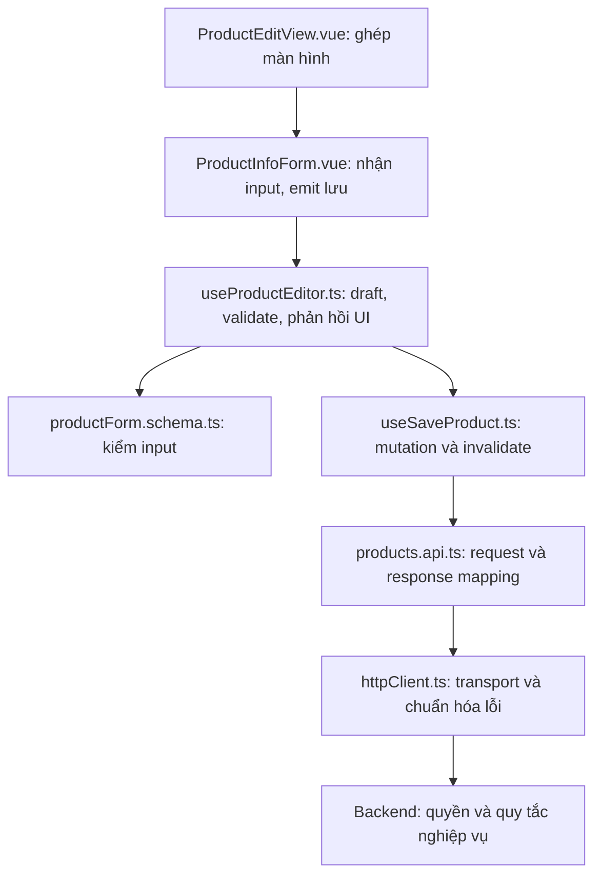

# Config, shared và luồng Lưu

> Thiết kế đã duyệt ngày 26/11/2026; chưa triển khai source. ADR là nguồn quyết định, tracker sở hữu delivery.

## Config và code dùng chung đặt ở đâu?

Đã duyệt Q16: phân theo owner/trách nhiệm, không gom mọi cấu hình vào shared/config và mọi hàm vào shared/utils.

| Trường hợp                            | Vị trí đề xuất                                               | Ví dụ và cách dùng                                                                                                    |
| ------------------------------------- | ------------------------------------------------------------ | --------------------------------------------------------------------------------------------------------------------- |
| Cấu hình công cụ                      | Root repo                                                    | vite.config.ts, vitest.config.ts, eslint.config.ts, playwright.config.ts, tsconfig*.json; giữ entry công cụ nhận diện |
| Biến môi trường/mặc định UI           | app/config                                                   | env.config.ts validate lúc khởi động; ui.config.ts là nguồn duy nhất mặc định Nuxt UI                                 |
| Tạo/cài thành phần dùng chung         | app/providers + app/runtime.ts                               | queryClient.ts tạo QueryClient theo chính sách lỗi; runtime nối HTTP/session/i18n và cấp cho consumer                 |
| Cấu hình riêng Backend                | integrations/backend/client                                  | httpClient.config.ts nếu thật sự cần tách default timeout; baseURL/token/locale nhận từ runtime                       |
| Cấu hình riêng một nghiệp vụ          | Module/workflow sở hữu                                       | productList.config.ts cho mặc định hiển thị list, chỉ tạo nếu có giá trị; không ghi đè quy tắc authoritative Backend  |
| Ngôn ngữ                              | i18n                                                         | i18n.ts và locales/vi.json/en.json; giữ cùng owner khi locale đổi                                                     |
| Token CSS                             | styles                                                       | main.css; không khai báo lại cùng màu/default trong nhiều config                                                      |
| Theme thông qua Vue                   | shared/composables                                           | useTheme.ts; key lưu theme có một nguồn, kiểm script chống nháy trong index.html                                      |
| UI dùng chung không biết nghiệp vụ    | shared/components                                            | DataTable.vue, ConfirmDialog.vue, PageHeader.vue                                                                      |
| Helper form/format thuần hoặc generic | shared/form, shared/formatting                               | applyApiErrorToForm.ts, formatMoney.ts, formatDate.ts                                                                 |
| Hàm/type/constant kỹ thuật dùng chung | shared/utils, shared/types, shared/constants khi thật sự cần | Không tạo kho hằng số/type toàn ứng dụng; chỉ thêm khi có consumer thật và owner rõ                                   |
| Nghiệp vụ được nhiều module sử dụng   | Module sở hữu, qua public entry                              | categories công khai category options cho products; không dời logic Danh mục vào shared                               |

```text
cms/
├── vite.config.ts
├── vitest.config.ts
├── eslint.config.ts
├── playwright.config.ts
├── tsconfig.json
└── src/
    ├── app/
    │   ├── runtime.ts
    │   ├── config/
    │   │   ├── env.config.ts
    │   │   └── ui.config.ts
    │   └── providers/
    │       ├── queryClient.ts          # Đề xuất owner factory QueryClient global
    │       └── errorHandling.ts        # Nối xử lý lỗi với UI/router
    ├── integrations/backend/
    │   ├── client/
    │   │   └── httpClient.ts
    │   └── errors/
    │       ├── apiError.ts
    │       └── errorPolicy.ts          # Phân loại lỗi, không gọi toast/router
    ├── modules/
    │   ├── categories/                # Public chức năng Danh mục khi products cần
    │   └── products/
    │       ├── product-list/
    │       │   └── productList.config.ts  # Ví dụ có điều kiện, không bắt tạo
    │       └── variants/utils/         # Hàm riêng nghiệp vụ không đưa lên shared
    ├── shared/
    │   ├── components/
    │   ├── composables/
    │   ├── form/
    │   ├── formatting/
    │   ├── utils/                     # Helper kỹ thuật có consumer thật
    │   ├── types/                     # Type kỹ thuật dùng chung khi cần
    │   └── constants/                 # Hằng số kỹ thuật dùng chung khi cần
    ├── i18n/
    └── styles/
```

Quan trọng: modules/shared/integrations không import ngược app/config để đọc global config. Runtime đọc cấu hình khởi động rồi truyền qua tham số hoặc Vue provide/inject; query consumer dùng QueryClient do plugin cung cấp. Config build-time ui.config.ts giữ thuần và không kéo dependency browser vào vite.config.ts. Cấu hình riêng một capability có thể được dùng trực tiếp trong chính owner; không buộc mọi constant qua injection.

Ví dụ đổi base URL: app đọc env và truyền baseURL khi tạo HTTP; module chỉ gọi endpoint. Đổi mặc định cache toàn app: sửa QueryClient factory; query từng chức năng có thể override khi có lý do. Đổi default bộ lọc sản phẩm: sửa owner product-list, không thêm vào global config. Khi error policy cần thông báo, policy chỉ phân loại, app/composable quyết định hiển thị; tránh integration phụ thuộc shared UI hoặc module.

Cấu hình vận hành như hạn mức COD/phí ship là dữ liệu Backend của settings, không hard-code vào app/config. Bản dịch Danh mục là dữ liệu Backend của categories, không trộn với i18n UI. Shared chỉ có code không chứa tri thức nghiệp vụ; code dùng một nơi giữ cạnh consumer.

## Luồng xử lý ví dụ khi bấm Lưu



Sơ đồ mô tả trách nhiệm/hành vi, không phải mọi mũi tên đều là import trực tiếp. Component nhận callback/emits qua view; không import composable/API để thực hiện lưu. Lỗi field/form có owner riêng, tránh thêm global toast trùng; Backend quyết định quyền và số liệu authoritative.

Tra cứu: [Mục lục chủ đề](README.md) · [Toàn bộ tài liệu](../../README.md).
